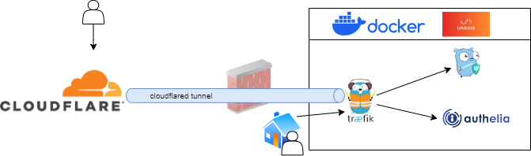

---
authors:
    - Bernd Verhofstadt
weight: 40
---
# Networking

The network design has moved from one flat Docker network to isolated
Compose-managed stacks. Traefik provides routed access, Blocky provides local
DNS, and Cloudflared provides an optional outbound tunnel for selected public
hostnames. These components have distinct roles; application containers do
not all share one network.

See [Docker Compose and network segmentation](Docker-Network-Segmentation.md)
for the per-host network model, private app/data tiers, host roles and
deployment checks.

- [Traefik reverse proxy](Reverse-Proxy.md)
- [Cloudflared tunnel](Tunnel.md)
- [Blocky DNS server](DNS-server.md)
- [CrowdSec protection](CrowdSec.md)

The home-automation host is designed for LAN-only access and is not connected
to the public tunnel. A tunnel creates an outbound connection and avoids
router port forwarding, but a hostname added to its ingress may still be
publicly reachable. Only publish services that are intended to be exposed.
